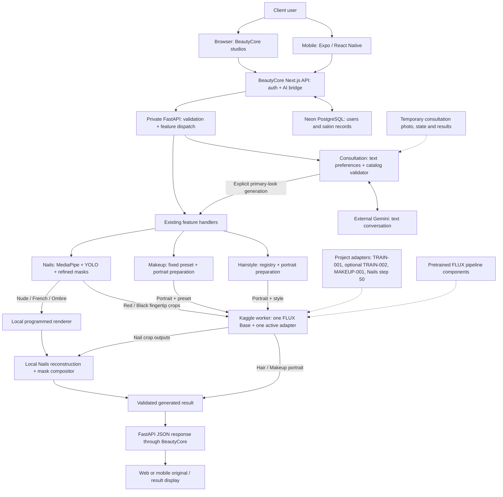
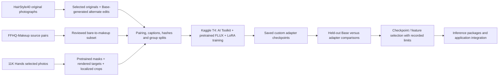

# BeautyCore and Andrea's AI Studio: Capstone Technical Handoff

**Prepared:** October 4, 2026, Asia/Manila  
**Purpose:** Explain the actual AI development, web system, and mobile application in language suitable for a capstone defense.  
**Inspected source:** `codex/mobile-02`, commit `1ab147e055a00f7694a77bda96f938c3166c2888`.

## 1. The project in one minute

We built a beauty preview system where a client can upload a portrait or hand photo, choose a style, and see a generated preview. It supports Hairstyle, Makeup, and Nails through a BeautyCore web application and an Expo mobile application. The main web application also contains salon accounts, appointments, profiles, and inventory workflows.

Our custom AI work is the preparation of paired editing datasets and the training of **LoRA adapters** for a pretrained image generator, FLUX.2 Klein Base 4B. An adapter is a small set of learned model adjustments. It changes how the foundation model generates an image for our task. Our adapters participate directly in image generation; they do more than recommend a label or write a prompt.

The application backend connects authentication, catalogs, consultation, image validation, feature processing, and remote GPU inference. Hair and Makeup generate edited portraits. Nails combines automatic nail detection with either learned generation or programmed rendering, then places the result only inside the selected nail mask.

Gemini is a separate external language model for consultation. It discusses the user's preferences and proposes catalog styles. The current consultation sends Gemini text, not the uploaded photo. FLUX handles the model based image previews.

**A short defense answer:**

> We developed a beauty preview application and fine-tuned a pretrained image generation model using our own prepared editing datasets. Our custom adapters generate hairstyle, makeup, and selected nail previews. A shared backend serves the web and mobile interfaces, while a remote Kaggle GPU performs the heavy image generation. Nail previews also use automatic masks and a renderer where the trained model did not reliably reproduce the required design.

## 2. How to read the evidence

This document distinguishes implementation from quality and deployment claims.

| Label | Meaning in this handoff |
| --- | --- |
| **VERIFIED** | Supported by inspected source, artifacts, or a specific recorded test. The accompanying scope matters. |
| **EXPERIMENTAL** | A real implementation or model exists, but quality or generalization is limited. |
| **CONFIRMED design** | An approved architectural choice. Its existence or acceptance is explained separately. |
| **Needs verification** | The available evidence does not establish the claim. |

The source, model contracts, training configurations, adapter bytes, and dated experiment reports were inspected for this document. All four selected adapter hashes were checked again. The local FastAPI catalog was unreachable during this inspection, so **current live availability needs verification**. No new training, GPU generation, mobile interaction, or database mutation was performed. Historical live evidence below retains its original date and test boundary.

Several early context summaries still describe mock-only behavior or training as not started. Those are **DOCUMENTATION DRIFT**. Later artifacts and dated experiments establish the completed work described here. Earlier plans for a second refinement model, distilled inference, or Hugging Face/Vercel hosting are not evidence that those paths were deployed.

## 3. What we developed and what we reused

| Component | Our project contribution | Reused technology |
| --- | --- | --- |
| Image generation | Hair TRAIN-001 and TRAIN-002, MAKEUP-001, and NAILS-001-LOCAL-v1 adapters; dataset preparation, run configurations, evaluation and integration | Black Forest Labs FLUX.2 Klein Base 4B and its pretrained pipeline components |
| Training | Paired data, captions, split checks, training runners, logs and checkpoint verification | Ostris AI Toolkit, PyTorch, and supporting ML libraries |
| Nail processing | Crop selection, geometry validation, mask refinement, renderer, crop reconstruction and protected compositing | MediaPipe Hand Landmarker and `mnemic/nails_seg_yolov8` |
| Consultation | Session lifecycle, catalog metadata, preference handling, recommendation validation, three-look presentation and generator handoff | External Google Gemini API for text conversation; an explicitly configured deterministic provider is also implemented |
| Web application | Integration of the existing BeautyCore application with the HAIR studios and authenticated AI adapter | Next.js, React, TypeScript, Tailwind CSS, Neon PostgreSQL and Drizzle |
| Mobile application | Native gallery, studios, consultation, cookie authentication, uploads, result comparison and request recovery | Expo, React Native, Expo Router, TanStack Query and Zustand |
| Serving | Central dispatch, remote clients, one-foundation adapter switching, safe errors, diagnostics and startup coordination | FastAPI, HTTPX, Kaggle GPU and Cloudflare temporary tunnel |

BeautyCore was imported from an existing project checkout. The unified work connects and adapts that application; it does not establish that every imported salon component was newly authored in this repository. Individual contributor attribution needs verification if the defense must name who authored each component.

We did not train FLUX, Gemini, MediaPipe, or the YOLO segmenter from scratch. The project's trained components are the generative adapters. No custom segmenter training is evidenced.

## 4. How the generative AI works

### 4.1 The foundation model and our adapter

The selected foundation is `black-forest-labs/FLUX.2-klein-base-4B`, pinned to revision `a3b4f4849157f664bdbc776fd7453c2783562f4d`. Black Forest Labs describes it as an undistilled, four billion parameter rectified flow transformer with image editing support. Its Base version is intended for customization and training. [Official model card](https://huggingface.co/black-forest-labs/FLUX.2-klein-base-4B).

In simple terms, the foundation already knows general image patterns. We teach small additional weights to guide it toward the edits in our datasets. **LoRA** means low rank adaptation: learning a compact adjustment instead of retraining every foundation weight. The adapter needs the foundation model to work.

This approach was appropriate because the project required a real custom pixel-generating component, had a small data budget, and used an external T4 GPU instead of a suitable local CUDA GPU. The experiments verified that this configuration could train and generate within the available setup. That feasibility does not guarantee good results for every image.

### 4.2 From an instruction to pixels

The model receives a reference image and a fixed instruction associated with the selected style. The pretrained pipeline encodes the instruction and image into numerical representations. It starts a new image representation from noise and repeatedly moves it toward a coherent image conditioned on that reference and instruction. The trained adapter changes the image model's behavior during these updates. A decoder turns the resulting representation into visible pixels.

This is a simplified explanation of the pipeline's flow matching process. It is not a classifier choosing an existing photograph. The reused pipeline includes a tokenizer and Qwen3 text encoder, an image encoder/decoder (VAE), a transformer, and a flow matching scheduler. These were not independently trained by this project. [Pinned model component list](https://huggingface.co/black-forest-labs/FLUX.2-klein-base-4B/blob/a3b4f4849157f664bdbc776fd7453c2783562f4d/model_index.json), [Diffusers Klein pipeline documentation](https://huggingface.co/docs/diffusers/api/pipelines/flux2#diffusers.Flux2KleinPipeline).

At runtime, our code uses `Flux2KleinPipeline`. Hair and Makeup use 512 × 512 images, 20 inference steps, guidance 4.0, and seed 1977. Guidance controls how strongly the instruction influences generation. A seed fixes the starting randomness for repeatable comparisons in the tested environment.

**Training steps and inference steps are different:** 250 training steps mean 250 model-learning updates. Twenty inference steps mean twenty image-generation updates for one request. The application does not retrain the model when a client uploads a photo.

### 4.3 Why the features use different paths

| Feature | Actual image method | Important distinction |
| --- | --- | --- |
| Hairstyle | FLUX Base with the Hair adapter selected by the style registry | Global portrait editing, with preservation requested in the prompt |
| Makeup | FLUX Base with one general MAKEUP-001 adapter and ten fixed prompt presets | Ten product presets are not ten separately trained models or ten FFHQ class labels |
| Classic Red and Glossy Black Nails | FLUX Base with the selected step-50 Nails adapter on individual fingertip crops | Crops are reconstructed and composited into the original hand |
| Nude Pink, French Tip and Pink Ombre Nails | Deterministic renderer using masks, fingertip direction, colors, gradients and source lighting | These outputs bypass generative GPU inference |

The active Hair catalog depends on the attached package. The default registry supports Crew Cut, Bob Hair, and Layered Hair through TRAIN-001. The expanded registry adds ten TRAIN-002 styles: Bun, Curtain Hair, Perm-Style Curls, Pixie Cut, Pompadour Undercut, Ponytail, Shag Hair, Shoulder-Length Hair, Side-Part Undercut, and Wavy Hair. All registry entries remain marked `experimental`. The launcher matches the registry to the signed package identity; the presence of the expanded JSON file alone does not prove the running worker supports it.

Makeup offers Natural Makeup, No-Makeup Makeup, Soft Glam, Smoky Glam, Dewy Peach, Rosy Pink, Bronze / Golden Glam, Matte Nude, Classic Red Lip, and Bold Evening Glam. These are instructions applied through the same adapter.

## 5. Data and model development

The common development sequence was:

**Data collection → paired examples → preprocessing and checks → LoRA training → held-out comparison → selected checkpoint → application integration.**

Training data contains a reference image, a desired edited target, and a caption describing the change. We keep examples from the same identity group in the same split so that validation does not simply repeat training examples.

### 5.1 Verified dataset and checkpoint summary

| Dataset / model | Selected source groups | Training pairs | Validation pairs | Completed training | Final use |
| --- | --- | ---: | ---: | --- | --- |
| DATA-001 / TRAIN-001 | 30 portrait groups: 24 train, 6 validation | 48 | 12 | 250 steps | Three experimental Hair styles |
| DATA-002 / TRAIN-002 | 120 portrait groups: 100 train, 20 validation | 200 | 40 | 500 steps | Ten additional experimental Hair styles in the expanded package |
| DATA-M001 / MAKEUP-001 | 12 FFHQ identities: 10 train, 2 validation | 50 | 10 | 250 steps | One general Makeup adapter, ten inference presets |
| DATA-N001, original full-hand representation | 20 selected subject groups: 16 train, 4 validation | 80 | 20 | Original Nails experiment: 25 steps | Research predecessor, five-style quality gate failed |
| DATA-N001 localized derivative / NAILS-001-LOCAL-v1 | Same approved split as DATA-N001 | 340 | 90 | 50 steps | Selected for Red and Black only |

The localized Nails pairs are crops from the same approved hands and targets, not 430 new people. Similarly, two Hair edit directions do not represent two different people. Hair source grouping and duplicate checks support the recorded split, but photographs of recurring celebrities can complicate proof of unique real-world identities.

### 5.2 Hair data: creating paired hairstyle edits

We obtained the original photographs from `yikaiwang/FaceSketches-HairStyle40` at revision `45de974926fe64551fc2d0b80973335e20ca10e2`. We used its `image/` photographs, not the sketch folders. The published dataset includes original hairstyle reference photographs. [Dataset source](https://huggingface.co/datasets/yikaiwang/FaceSketches-HairStyle40).

For DATA-001, we selected ten photographs for each of CrewCut, BobHair, and LayeredHair. Pretrained FLUX Base, without the project LoRA, generated an alternate hairstyle for each source. The plan followed CrewCut → BobHair → LayeredHair → CrewCut. Each original/counterpart relationship then supplied two directions: original to alternate, and alternate back to original. Thirty original groups therefore produced sixty directional edit pairs.

The source groups were assigned to train or validation before pairing. Captions described the requested hairstyle and asked to preserve the person and scene. The finalizer checked image decoding, dimensions, hashes, captions, balance, duplicates and split separation. Thirty explicit ACCEPT decisions were recorded. Later inspection still found significant appearance drift in some accepted counterparts. File correctness and visual correctness are separate gates.

DATA-002 expanded to ten hairstyle categories with twelve selected originals per category. A frozen two-neighbor mapping distributed alternate edits across styles; each original had one generated counterpart and both directions were retained. The finalized package contains 200 train and 40 validation directions. The source portraits were screened for useful style examples, but the generated counterpart dataset was finalized through an authorized `automated_unreviewed` path. **Human visual QA of those counterparts was not performed.** Its Philippine-oriented style selection is a product choice, not evidence of a representative Filipino population dataset.

Sources: [DATA-001 record](../data/DATA-001.md), [final DATA-001 review](../data/DATA-001-practical-completion.md), [DATA-002 selection](../data/DATA-002.md), [recovered final DATA-002 archive](../experiments/DATA-002-recovery.md).

### 5.3 Makeup data: using existing paired edits

The final Makeup data came from the downloaded `cyberagent/FFHQ-Makeup` archive at revision `25955d8cb70e97b00f3ee9eacffabc9d3fda81a7`. The local archive audit recorded 18,370 identity directories, each containing a bare image and five makeup variants. The project trained on a small selected subset, **not that entire archive**. [Published dataset](https://huggingface.co/datasets/cyberagent/FFHQ-Makeup), [project archive audit and final selection](../data/DATA-M001.md#stage-10-update-real-paired-data-m001-finalized).

We selected twelve identities and retained all five bare-to-makeup pairs for each: fifty training pairs from ten identities and ten validation pairs from two other identities. The Project Lead approved all sixty selected pairs from comparison sheets. Source member names, image hashes, attribution records, captions, reviews and split information were preserved.

These are existing externally constructed makeup edits, not photographs of sixty independent real cosmetic sessions. The source method transfers sampled makeup appearances onto FFHQ identities. The suffixes `makeup_01` to `makeup_05` identify variant positions for each person. They do not mean Natural, Smoky, Red Lip, or another global class. We therefore used general makeup-edit captions and trained one general adapter. Product styles are controlled by inference prompts.

Earlier project experiments generated synthetic Makeup targets and tried preservation and inpainting methods. They had unacceptable facial reconstruction or poor style separation. **None of those experimental targets appears in the final DATA-M001 training dataset.** The approved source pairs can still contain smoothing or retouching.

### 5.4 Nails data: teaching a local edit

The source was the author's 11K Hands dataset. Its images and metadata allow selection by subject, hand side, dorsal/palmar view, polish and accessories. The project selected twenty subject groups, keeping sixteen for training and four for validation. We did not train on all source images. [11K Hands source and citation](https://sites.google.com/view/11khands), [DATA-N001 record](../data/DATA-N001.md).

The existing MediaPipe hand model found hand landmarks. The pretrained YOLO nail segmenter estimated which pixels belonged to the nails. A **mask** is a map identifying the region allowed to change. The segmenter's twenty selected mask overlays were visually accepted. We did not create or train this segmenter. [External segmenter](https://huggingface.co/mnemic/nails_seg_yolov8).

Our renderer produced five target designs on each accepted hand. The targets retained source lighting and added programmed colors, highlights, a white French tip, or an Ombre gradient within the mask. The revised one hundred target pairs received practical visual acceptance, and pixel checks found no changes outside the masks. These are synthetic rendered targets, not photographs of completed manicures.

The first 25-step full-hand training experiment failed the five-style quality gate. One reason investigated was the small editable region: nails occupied only about 0.793% of the original training images on average. The later localized representation cropped and oriented fingertips, transformed reference and target identically, and enlarged them to 512 × 512. The nail region then averaged 11.252% of training image area. This made the edit a larger part of each example.

The approved crop process yielded 340 train and 90 validation pairs while preserving the subject split. At step 50, the trace showed fifty distinct training pairs had been used, only about 14.7% of the train pairs. The five-style model gate still failed. The Supervisor froze further training and selected the hybrid app path: the custom model for Red and Black; the renderer for the other three styles. This was a deliberate response to the measured results.

Sources: [construction](../experiments/DATA-N001-construction.md), [localized step-50 evaluation](../experiments/NAILS-001-LOCAL-v1-step050-evaluation.md), [hybrid selection and implementation](../experiments/NAILS-001-hybrid-integration.md).

### 5.5 Why preprocessing mattered

| Preparation step | Purpose |
| --- | --- |
| Decode and verify images | Reject unreadable or mismatched files before training or inference |
| Normalize image size and color format | Give the model consistent input; the generative training uses 512 resolution |
| Align reference, target and caption filenames | Ensure each instruction teaches the intended edit on the intended image |
| Freeze manifests and hashes | Identify exactly which data and checkpoint produced a result |
| Split by identity group | Keep related originals, targets and crops out of the opposite split |
| Review targets | Identify drift, artifacts or incorrect style examples that file checks cannot detect |
| Crop and orient Nails examples | Increase the editable region and keep reference/target geometry aligned |

At application inference, uploads also receive orientation correction and RGB conversion. Hair and Makeup are resized with aspect-preserving padding to 512 × 512. Padding avoids stretching the person, but the result is still a square preview and does not retain the original alpha transparency.

### 5.6 How training was performed

The recorded generative training runs used one Kaggle Tesla T4 and a pinned Ostris AI Toolkit commit, `a8dfcf7d7e2b38ccc7b2fb68ece9c6358e61e7a7`. AI Toolkit is an external training framework; our notebooks and scripts prepare, constrain and record its runs. [Toolkit source](https://github.com/ostris/ai-toolkit).

For each training update, the trainer loads a reference image, its edited target, and the caption. It teaches the image model's adapter to predict the target's generation path while conditioned on the reference and instruction. The **loss** measures training error in that objective. The optimizer adjusts the LoRA weights to reduce it. Validation examples are kept out of these updates.

The main configuration uses batch size 1, 512 resolution, learning rate `0.0001`, AdamW8bit optimizer, and `flowmatch` scheduling. LoRA linear rank/alpha are 16/16, with configured convolution rank/alpha 8/8. BF16 training, quantization, low-VRAM settings and gradient checkpointing reduce memory pressure. The text encoder is not trained. Saved adapter weights use FP16. Early FP16 training produced non-finite loss; the verified BF16 path addressed that training problem. FP16 inference is a separate runtime setting and is used successfully in the serving records.

Each completed run retained its configuration, runtime details, logs, `.safetensors` checkpoint and optimizer state. A checkpoint stores the learned weights. The optimizer state is training bookkeeping; it is not required for ordinary image generation. We verified checkpoint identity using SHA-256 hashes, which act as file fingerprints.

| Model | Completed updates | Recorded run time including load | Meaning |
| --- | ---: | --- | --- |
| TRAIN-001 | 250 | About 2 h 22 min | First three-style Hair adapter |
| TRAIN-002 | 500 | About 4 h 58 min | Separate expanded Hair adapter, not a TRAIN-001 continuation |
| MAKEUP-001 | 250 | About 2 h 24 min | General bare-to-makeup adapter |
| NAILS-001-LOCAL-v1 | 50 | About 30 min | Localized Nails adapter selected for two styles |

These times belong to specific runs, not guarantees for future GPU sessions. Training completion and finite loss prove that learning updates ran and artifacts were saved. They do not prove visual quality, absence of memorization, or broad generalization.

### 5.7 What the adapters learned, and what the evidence shows

The intended learning task was to change the requested beauty region while retaining the source person or hand. The actual observed behavior is more limited:

| Model | Evaluation performed | Supported conclusion and limitation |
| --- | --- | --- |
| TRAIN-001 | Twelve held-out directions, Base versus adapter, 24 outputs | Some hairstyle changes appeared. Face and scene reconstruction remained unreliable; consistent improvement over Base was not established. It was later authorized for experimental app use. |
| TRAIN-002 | Ten held-out directions, one per added style, 20 Base/adapter outputs | Several requested styles were visible. Base already followed many prompts. Curtain Hair, Pompadour Undercut and Side-Part Undercut showed concerns. One example per style is weak generalization evidence. |
| MAKEUP-001 | Two held-out identities × ten presets × Base/adapter, 40 outputs | Project Lead approved practical displayed quality. Several cosmetic regions looked more coherent than Base, but faces were retouched and subtle styles overlapped. No quantitative identity-preservation proof. |
| NAILS-001-LOCAL-v1 | Four held-out index fingertips × five styles × Base/adapter, 40 outputs | Raw crop preservation improved. Black was closer to rendered targets on all four hands; Red was mixed. Nude and French failed, and Ombre structure was inconsistent. Five-style quality gate failed. |

Comparisons used matched inputs, prompts, seeds and generation settings within each experiment. Review considered requested style, recognizable identity, face or hand preservation, realism, unwanted changes and artifacts. Nails also measured **MAE**, average pixel difference, inside and outside masks. Lower MAE means closer pixel values to the comparison target; a synthetic target can itself look unrealistic.

For localized Nails, raw outside-nail MAE averaged 10.218 for Base and 2.997 for the adapter. Final composites changed zero outside-mask pixels on the evaluated examples. That final guarantee comes from compositing, not from perfect behavior of the generative model.

The mask refinement experiment compared ten nails across two hands against manually outlined reference masks. Mean **IoU**, overlap between predicted and reference regions, improved from 0.828 to 0.851, with less skin overcoverage but more missed nail area. This is a bounded geometry result, not a broad nail-detection accuracy score.

Sources: [TRAIN-001 results](../experiments/TRAIN-001.md), [TRAIN-002 run](../experiments/TRAIN-002-run.md), [TRAIN-002 comparison](../experiments/TRAIN-002-evaluation.md), [MAKEUP-001 evaluation](../experiments/MAKEUP-001-evaluation.md), [Nails evaluation](../experiments/NAILS-001-LOCAL-v1-step050-evaluation.md), [mask refinement results](../experiments/nails-highres-geometry-2026-09-27/RESULTS.md).

There is no defensible single “AI accuracy percentage” for this project. A large user study, robust demographic evaluation, standardized identity metric, and statistically established advantage over Base **need verification**.

## 6. Main AI system: upload to result

### 6.1 Common request flow

1. The client signs in, chooses a feature and obtains its available style catalog.
2. The web or mobile interface submits the selected image and `style_id` to BeautyCore's `/api/ai/features/{feature}/generate` route using multipart form data.
3. BeautyCore checks the authenticated user against the database, requires the Client role, validates the request origin and allowed operation, and forwards it to private local FastAPI.
4. FastAPI dispatches to the existing Hair, Makeup or Nails handler. It checks the style and validates the image: JPEG/PNG, at most 8 MiB, 64 to 4096 pixels per dimension, readable content and matching file type. It corrects orientation and converts to RGB.
5. The feature handler performs its own preprocessing and invokes either remote model inference or local Nails rendering.
6. The result is validated and packaged as JSON containing status, generator, selected style, image and metadata. The generated PNG is carried inline as a base64 data URL, with content type and dimensions.
7. BeautyCore returns the result to the client, which displays the generated image and allows comparison with the original.

**API** means the agreed request/response interface between programs. **Multipart** sends the image as file bytes alongside form fields. **Base64** encodes returned image bytes as text for inclusion in JSON. This route does not require an object-storage URL to display the result.

Source: `backend/app/main.py`, `beautycore/lib/ai/adapter-core.ts`, the three remote clients, and the web/mobile API clients.

### 6.2 Hairstyle path

**Portrait → validation and padding → registry prompt and Hair adapter → remote FLUX edit → PNG validation → displayed portrait.**

The registry maps a style ID to its prompt and TRAIN-001 or TRAIN-002 adapter. The worker verifies the selected checkpoint and generates a global 512 × 512 edit. The active application path does not apply a hair-only mask compositor or a second pretrained refinement pass. Hair-region preservation probes in the research history are not the serving pipeline. Preservation is requested through the prompt and learned behavior, so facial and background drift can occur.

### 6.3 Makeup path

**Portrait → validation and padding → fixed preset prompt + MAKEUP-001 → remote FLUX edit → provenance/image validation → displayed portrait.**

The Makeup client checks the expected model revision, adapter ID/hash, preset hash and returned image. No style-specific classifier selects a separate makeup model. The serving path does not use the discarded dataset-preservation compositor or an active cosmetic-only mask. Smoothing and facial reconstruction remain possible.

### 6.4 Nails path

**Hand photo → hand landmarks → coarse nail segmentation → original-resolution mask refinement → style branch → reconstruction/compositing → original-sized PNG.**

The pipeline requires one clear detected hand with three to five visible nail regions. Unusable geometry can produce a retake error. Its coarse 512 view supports landmark/mask mapping; the same pretrained segmenter also processes fingertip regions from the original-resolution photo to refine final boundaries. It runs in an isolated local CPU environment.

For Red or Black, each valid fingertip is oriented and cropped to the model's 512 × 512 representation. The backend sends crops sequentially to the remote FLUX/Nails adapter, reverses the crop transformations and assembles the edited nail regions. A five-nail request therefore makes five generative crop calls, which explains its longer runtime.

For Nude Pink, French Tip or Pink Ombre, the backend uses the renderer directly. It calculates polish appearance using the selected mask, source shading and fingertip direction. This branch makes no generative GPU call.

Both branches finish with the same original-resolution nail-only compositor. It blends edges inward and checks that pixels outside the chosen final mask match the orientation-corrected RGB original. This protects skin and background outside that mask. An inaccurate mask can still include skin or miss nail plate; exact outside-mask preservation does not prove anatomically perfect placement.

Sources: `backend/app/nails/hybrid.py`, `geometry.py`, `localized.py`, `segmentation.py`, `render.py`, and `contract.py`.

### 6.5 Consultation: recommendations before generation

Consultation presents **Service → Direction → Your Looks**. The user chooses one primary service, uploads the appropriate photo and describes preferences. In Gemini mode, the backend sends text preferences, conversation and eligible style metadata to Gemini. The configured default model is `gemini-3.5-flash-lite`; this is the inspected project setting, not a claim about the newest provider model.

Gemini asks for more information or proposes exactly three unique primary styles. FastAPI checks the proposal against the active catalog, current exclusions and required conversation state before saving it. Any complementary suggestions must also match catalogs. Prices and durations come from backend-owned demo estimates, not from Gemini or a verified booking quote.

Each primary recommendation requires an explicit Generate action. The existing feature dispatcher reuses the stored original photo and the recommendation's primary style ID. Results are generated separately; complementary suggestions are not automatically rendered. **Select** records a completed look in temporary consultation state. It does not create an appointment or payment. **Custom** carries the local original photo to the appropriate manual studio.

The recommendation system has an explicitly configured deterministic alternative. It must not silently replace a failed Gemini request. Current Gemini consultation is text only; it does not analyze face shape, skin tone, or nail appearance from the uploaded photo.

## 7. Web and server architecture

### 7.1 The user-facing application

The current root `START.bat` launches **BeautyCore under `beautycore/`**, plus private FastAPI under `backend/`. BeautyCore uses Next.js 16 and React 19 with TypeScript. It serves both the browser interface and application API routes.

The Client AI entry points are `/client/ai-consultation`, `/client/hair-studio`, `/client/makeup-studio` and `/client/nail-studio`. Their pages adapt the original HAIR studios to the authenticated `/api/ai/*` bridge. The earlier Client Advisor page redirects to Consultation. The original `frontend/` remains an earlier direct-FastAPI application and rollback reference; root START does not use it as the current main application.

The code contains Admin, Stylist and Client roles with corresponding portal pages. Ordinary Next.js APIs connect accounts, profiles, appointments and inventory to the database. The existence of finance, security or market-trend screens should not be presented as proof of payment processing, a complete security audit, or independently verified market analytics. End-to-end acceptance of every business screen needs verification.

### 7.2 Responsibilities of the two server layers

| Layer | Responsibility |
| --- | --- |
| BeautyCore Next.js server | Browser pages, login/session, database-backed role checks, business APIs, and an allowlisted AI bridge |
| Central FastAPI server | Feature catalogs, upload validation, consultation state and Gemini integration, feature dispatch, Nails CPU processing, remote inference clients, safe errors and diagnostics |
| Remote Kaggle FastAPI worker | Load the pinned pretrained foundation, verify/switch custom adapters, serialize GPU work and return generated images |

BeautyCore signs session cookies with JWTs and hashes passwords with bcrypt. The AI bridge requires a current database Client role. For consultation, it gives the client an opaque signed handle bound to that user and an expiry. The client sends the handle back; it does not directly address raw FastAPI session IDs.

FastAPI is private loopback in the current local topology. Its feature routes rely on the application boundary for client authentication. It should not be described as a publicly exposed independently authenticated user API. Remote GPU credentials and the Gemini key stay on the server side; clients know the application origin.

### 7.3 Database, files and temporary state

BeautyCore connects to **Neon PostgreSQL** using the Neon serverless driver and **Drizzle ORM**, a library that maps application operations to database tables. The schema includes users, client profiles, appointments, inventory and an existing AI-generations table.

The integrated `/api/ai/*` path forwards FastAPI responses and does **not** insert its generated results into that AI-generations table. The old `/api/generate` route has a separate persistence/provider path, and the inspected local configuration selects its `stub` provider. Its presence does not prove that current Hair/Makeup/Nails studio images appear in historical generation reporting. The old enum also supports `hair` and `nail`, not Makeup. Automatic database history for the integrated studios needs verification or additional implementation.

Consultation photos, messages, statuses, results and selection are held in FastAPI process memory. The store allows ten sessions, with a one-hour lifetime refreshed by relevant updates. Process restart or expiry loses this state. Mobile drafts, handles and unsaved results are also temporary memory state. This is not a durable job queue.

Training datasets, checkpoints, private runtime packages and experiment outputs are separate filesystem artifacts. Some are ignored by Git. No S3, Supabase, or equivalent object-storage integration is established for the current studio path. Database configuration does not mean all uploaded images are permanently stored.

### 7.4 How the features share infrastructure

All three features use the central catalog/dispatch contract and common result structure, while retaining different processing handlers. The preferred verified GPU topology uses one unified worker, one loaded FLUX foundation, and one active adapter at a time. Hair can additionally select between its two adapters when the expanded package is attached.

The worker unloads the previous LoRA, loads the required checkpoint and verifies its active tensors before generation. It serializes ownership so another request cannot switch weights during active inference. GPU work can report busy instead of accepting competing generation. The three adapters are not merged into one newly trained model. CPU Nails detection, rendering and final compositing remain local.

The shared GPU URL/key configuration selects feature-prefixed endpoints on the unified worker. Original separate GPU servers remain an explicit configuration rollback. Earlier Gate 1 and Gate 2 records tested compatibility and switching; Gate 3 established representative live web integration with one worker. The old wording that shared serving was only proposed is superseded by that evidence.

**Working together** means shared application access, consultation catalogs, dispatch, response format and GPU foundation. It does not mean a single request automatically applies Hair, Makeup and Nails to one combined image. Portrait and hand-photo features have different input needs.

## 8. Mobile application

### 8.1 Technologies and responsibilities

The mobile application is `mobile/`, displayed as Andrea's AI Studio. Its manifest specifies Expo SDK 57, React Native 0.86.3, React 19, TypeScript and Expo Router. TanStack Query supports server-data access; Zustand stores temporary drafts and operation state. Expo modules provide gallery selection, file handling and native sharing.

The phone handles login, navigation, selecting a gallery photo, local file checks, style/preferences input, uploads, progress/status display, original/result comparison and explicit result actions. It does not load FLUX weights, train adapters or run the generative model locally. The current implemented picker uses the gallery; camera capture is not part of this flow.

The server authenticates the Client, validates images/styles and recommendations, manages consultation state, calls Gemini or the GPU worker, executes Nails processing and returns the result. The mobile application reuses the same AI system as the web.

### 8.2 Actual mobile request sequence

**Mobile app → BeautyCore API → private FastAPI → feature pipeline → GPU or renderer → FastAPI result → BeautyCore → mobile display.**

1. Login calls `/api/auth/login`; subsequent requests include the existing native session cookies. Mobile does not store a GPU API key or database credential.
2. The app loads `/api/ai/features/{feature}/styles`. A manual studio moves through Photo → Style → Review.
3. The gallery photo becomes an Expo filesystem `File` inside multipart `FormData`, alongside `style_id`. It is sent to `/api/ai/features/{feature}/generate`. The SDK 57 implementation uses a File rather than the older React Native URI descriptor.
4. BeautyCore forwards the request into the same private FastAPI and model pipeline used by the web.
5. The mobile client validates the returned real result and style ID, then displays its inline image alongside the retained original.

For Consultation, mobile creates a session, keeps its opaque signed handle, uploads one photo, submits preferences and sends the user's first description. It receives validated recommendations, generates a selected look, reads its status when needed, and submits Select. The final flow avoids the empty opening Gemini turn that was rejected in an earlier phone test.

Custom result Save on Android uses the system's chosen-folder grant. Share opens the native sharing sheet through a temporary cache file and cleans up that file. The Consultation result route provides original/result comparison and Select; it is not a booking action.

### 8.3 Long requests and response loss

Hair and Makeup can take roughly a minute in the recorded environment, while five-nail model generation can take several minutes. The UI shows elapsed time, not an invented completion percentage. Mobile does not apply its ordinary short read deadline to generation.

Custom and Consultation share an operation guard to block duplicate generation actions. There is no automatic generation POST retry. If a consultation response is lost, the app uses a GET status read to recover a completed or failed result. An unknown or still-active outcome keeps the guard locked.

Manual Custom generation has no durable job/status endpoint or idempotency key. An ambiguous response loss needs operator confirmation that processing ended before another request. Restarting the app is not guaranteed job recovery. These limits matter when explaining reliability.

### 8.4 Mobile deployment and verified boundary

The demonstrated mobile environment is **Expo Go on one physical Xiaomi Android 12 phone**. The normal Windows launcher requires the existing BeautyCore stack and authorized USB reverse for ports 3000 (application API) and 8081 (Expo development server). It starts and owns Expo only. This current mode refuses LAN-only startup because the application and private FastAPI remain loopback services.

Android/web exports and browser fixtures passed in the recorded work, but they do not prove an installed release APK, App Store publication, iOS device acceptance, or public Internet mobile deployment. Those **need verification**.

The October 3 Hair phone evidence covers real login/session access, Gemini conversation, three validated recommendations, one Bob Hair generation, visible original/result comparison, Select and Custom photo handoff. Phone visuals and taps were manually confirmed by the Supervisor; HTTP/worker behavior was supported by logs. Standalone Makeup requests returned HTTP 200, but Android visual acceptance was deferred. No standalone live Android Nails generation was recorded.

Sources: [mobile integration](mobile-02b-integration.md), [Consultation contracts](mobile-02c-integration.md), [mobile request evidence](../experiments/mobile-02b.md), [live Android Hair Consultation](../experiments/mobile-02c.md), [latest mobile UI acceptance](../experiments/mobile-consultation-ux.md).

## 9. Complete system diagrams

### 9.1 Runtime architecture

Solid arrows represent requests or returned results. Dashed arrows show support relationships. The preferred capstone topology is local application services plus a remote unified Kaggle worker.



The database arrow does not imply that integrated studio images are saved there. It represents authentication and ordinary salon data. The renderer bypass and Nails compositor are separate from the GPU worker.

### 9.2 Model development, separate from user requests



DATA-002 counterpart visual QA was not performed. The QA box includes structural checks and the reviews that actually occurred; it does not imply every dataset passed the same human quality gate. User uploads are inference inputs, not an implemented automatic training-data collection process.

### 9.3 Mobile upload and return

```mermaid
sequenceDiagram
    actor Client
    participant App as Expo mobile app
    participant Beauty as BeautyCore API
    participant AI as Private FastAPI
    participant Engine as GPU model or local Nails renderer
    Client->>App: Choose photo and style, then Generate
    App->>Beauty: Cookie-authenticated multipart image + style_id
    Beauty->>Beauty: Check Client role, origin and allowed operation
    Beauty->>AI: Forward to feature generation route
    AI->>AI: Validate image and prepare feature input
    AI->>Engine: Run selected generation path
    Engine-->>AI: Edited portrait or nail proposal
    AI->>AI: Validate output; composite Nails if applicable
    AI-->>Beauty: Status + style + inline image + metadata
    Beauty-->>App: JSON result
    App-->>Client: Display original and generated result
```

## 10. What the completed tests actually establish

| Recorded gate | What was verified | Boundary |
| --- | --- | --- |
| Unified Gate 3, September 28 | Real original web pages → central FastAPI → one worker, Hair → Makeup → model Nails → Hair; renderer bypass; one Base load | Representative capstone integration, not production hosting or all-style quality |
| Consultation live gate, September 30 | Nine primary results: three Hair, three Makeup, three Nails; correct adapter selection and post-Nails Hair restoration | Used deterministic recommendations, before the Gemini integration gate |
| Gemini live conversation, September 30 | Hair, Makeup and Nails each returned three backend-validated recommendations | Text conversation gate, not three full Gemini-to-GPU rehearsals |
| Mobile live work, October 3 | Real Crew Cut and Bob Hair paths; Bob Hair Consultation including Gemini and Select; Makeup server responses | Hair phone acceptance established; standalone Makeup visual and Nails live phone gates deferred |
| Latest mobile refinement, October 3 | 37 mobile tests, typecheck/lint, Expo checks/exports, small-width fixtures and positive Supervisor UI feedback | No new GPU generation during that UI pass |

The recorded backend regression suite reached 408 passing tests, with 26 BeautyCore AI tests in the mobile integration records. Those counts describe the cited runs; this documentation task did not rerun them. Browser fixtures test interactions and error contracts. They are not evidence of model quality or actual native device behavior.

Recorded examples provide realistic expectations: Hair and Makeup requests took about 64 to 70 seconds in the representative Consultation gate. Model Nails took about 204 to 234 seconds; renderer Nails about 12 seconds. A separate fixed Classic Red case took 365.375 seconds at 20 steps and 221.000 at 8 steps. The inspected local configuration selects 8 for Nails, while code default remains 20 and supported choices are 8/12/20. Reduced-step Black quality was not separately reviewed. These are individual measurements, not latency guarantees.

Sources: [unified live review](../experiments/unified-kaggle-gate3.md), [nine-result Consultation gate](../experiments/CONSULTATION-02-live-gate.md), [Gemini gate](../experiments/CONSULTATION-03.md), [Nails latency comparison](../experiments/nails-latency-comparison-20260928.md).

## 11. Limitations and items needing verification

| Area | Known limitation or verification gap |
| --- | --- |
| Hair preservation | Global editing can reconstruct facial details, change clothing/background, or miss the exact style. A prompt is not an exact preservation constraint. |
| Hair evidence | TRAIN-002 counterparts were not visually reviewed; the evaluation has only one direction per added style. Some style shapes are questionable. |
| Makeup | Retouching, skin/lighting changes, and weak separation of subtle presets remain. Only two validation identities were tested. |
| Nails | Mask edges can spill onto skin or clip plate tips. Material can look flat, overly smooth or artificial. The five-style trained-model gate failed. |
| Image types and resolution | Current uploads are JPEG/PNG. Hair/Makeup return square 512 previews, and RGB conversion loses original transparency. Nails returns original dimensions, but its generated material comes from 512 views/crops. |
| New users | Broad performance across demographics, lighting, poses and devices needs verification. Small pilot splits cannot establish it. |
| Availability | Kaggle sessions and temporary Cloudflare tunnels can expire or fail. Recorded 502/530 incidents exist. The cause of the earlier Gate 3 transport interruption remains unknown. |
| Capacity | One GPU foundation with serialized generation; no verified production-scale queue, load benchmark or availability guarantee. |
| Persistence | Consultation is bounded process memory. No durable generation job system or automatic database history for integrated studios. |
| Mobile | One Android device accepted for the representative Hair flow. Standalone Makeup visual acceptance, standalone Nails live generation, isolated native logout/re-login confirmation and iOS acceptance remain incomplete. |
| Deployment | Persistent public hosting, signed installable mobile release and full portable client deployment acceptance need verification. |
| Data permissions | Dataset terms and source attribution are recorded, but comprehensive subject consent, individual-photo clearance and downstream distribution permission need verification. Do not infer these from successful training. |

The Hair source card declares Apache-2.0, while the FFHQ-Makeup card declares CC BY-NC-SA 4.0. The 11K Hands author states reasonable academic fair use with citation. These are source descriptions, not blanket clearance for publishing all selected images or commercial deployment. Keep the recorded attribution and obtain the appropriate rights review before distribution beyond the academic scope. [Hair source terms](https://huggingface.co/datasets/yikaiwang/FaceSketches-HairStyle40), [Makeup source terms](https://huggingface.co/datasets/cyberagent/FFHQ-Makeup), [Hands source terms](https://sites.google.com/view/11khands).

## 12. Practical handoff and defense preparation

The capstone runs as a local application supported by an external GPU session. The Kaggle notebook starts the verified worker and temporary tunnel, then publishes signed, expiring endpoint metadata through an ntfy mailbox. Windows discovery validates that record and the worker, and supplies the endpoint to local processes. The mailbox is startup coordination; it does not carry user images or sit between each image request and the GPU.

The root BeautyCore START/STOP launchers manage only their owned local processes. The mobile START/STOP launchers manage Expo in the current authenticated USB setup. Reuse the documented workflows, with the package and catalog matched, rather than changing a temporary URL in client code.

| Handoff item | Where it is documented |
| --- | --- |
| Current unified folder, private assets and application setup | [Unified BeautyCore guide](unified-beautycore.md) |
| Original GPU startup/discovery workflow | [Capstone startup guide](capstone-start.md) |
| Expanded Hair package with TRAIN-002 | [Expanded package guide](capstone-train002.md) |
| Authenticated mobile development and one-time prerequisites | [Mobile README](../../mobile/README.md) |
| Native Consultation contract and recovery behavior | [Mobile Consultation guide](mobile-02c-integration.md) |
| Findings from this handoff inspection | [Handoff audit](../experiments/capstone-technical-handoff-audit.md) |

A source-code folder alone is not a complete runtime installation. The operator also needs the configured database, private environment files, installed dependencies, the local pretrained Nails assets and isolated segmenter environment, verified custom adapter packages, a working Kaggle GPU session, and network access for external services. Credentials, private photos and temporary endpoint values are intentionally absent from this document.

For the defense, use the verified Hair path as the strongest native example. Describe the web three-feature evidence separately. State whether each demonstrated Nail style is model generated or renderer generated. A successful HTTP response establishes a completed request; visual acceptance still needs inspection.

### Questions you should be able to answer

**What did we build?**  
A beauty preview system with web and mobile interfaces, three feature pipelines, guided consultation, an authenticated application bridge and remote GPU generation integrated into BeautyCore.

**Is the AI ours?**  
The foundation is external. We prepared task datasets and trained our own LoRA weights, then built the processing and serving integration. Those weights directly affect generated pixels.

**Why use a pretrained model?**  
It provides general image generation knowledge. Learning compact adapters made a real custom generative component feasible with our limited data and verified T4 setup.

**How was the model trained?**  
Using paired references, edited targets and instructions. AI Toolkit updated LoRA weights on the training split; separate held-out examples were used for Base-versus-adapter comparisons.

**What data did we use?**  
Selected HairStyle40 photographs with Base-generated hairstyle counterparts, a reviewed FFHQ-Makeup pair subset, and selected 11K Hands photos with rendered nail targets and localized crop derivatives.

**Does Gemini generate the hairstyle?**  
Current consultation Gemini proposes styles from text preferences. FLUX with the selected project adapter generates the portrait preview. Gemini does not see the consultation photo.

**How do the backend and phone connect?**  
The phone sends cookie-authenticated requests to BeautyCore. Its AI bridge forwards permitted operations to private FastAPI, which invokes the feature pipeline and returns the image through the same chain.

**How do Hairstyle, Makeup and Nails work together?**  
They share access, catalogs, dispatch and a GPU foundation. Each keeps its own prompt/adapter or processing method and returns a separate result. There is no automatic combined full-beauty image pipeline.

**Why are some nail styles rendered?**  
The five-style training evaluation failed. The hybrid decision retained the custom model for Red/Black and used deterministic rendering for the other designs, with common mask-based preservation.

**Did our model outperform Base?**  
Not consistently across every feature. Makeup had practical visual approval on a small held-out sample, and localized Nails showed measured preservation gains. Hair comparisons did not establish consistent superiority. We report that limitation.

**Is everything saved and production deployed?**  
Salon records use PostgreSQL, but current integrated AI consultation/results are temporary. The demonstrated setup uses local services, Expo Go and a temporary Kaggle tunnel. Durable deployment and full result history remain separate gaps.

**What should the panel remember?**  
Our contribution is task-specific generative adaptation plus an integrated, tested web/mobile system. The implementation works on recorded representative paths, and its quality, persistence and deployment limits are explicitly documented.

## Appendix: source map and checkpoint identity

Paths below are relative to the repository root. These are references for the technical recipient, not details you need to memorize for the defense.

| Area | Key inspected files |
| --- | --- |
| Web access and authentication | `beautycore/app/api/ai/[...path]/route.ts`, `beautycore/lib/ai/adapter-core.ts`, `beautycore/lib/ai/consultation-handle.ts`, `beautycore/lib/auth.ts` |
| Business data and older AI history | `beautycore/db/schema.ts`, `beautycore/db/index.ts`, `beautycore/app/api/generate/route.ts`, `beautycore/lib/ai/preview.ts` |
| Central API and catalogs | `backend/app/main.py`, `styles.py`, `registry.py`, `style_registry.json`, `style_registry_train002_smoke.json`, `makeup_styles.py`, `nails/styles.py` |
| Model contracts and clients | `backend/app/generation/remote_flux.py`, `remote_makeup.py`, `remote_destination.py`, `backend/app/makeup_contract.py`, `backend/app/nails/contract.py`, `remote.py` |
| Nails processing | `backend/app/nails/hybrid.py`, `geometry.py`, `localized.py`, `segmentation.py`, `render.py`, `scripts/nails_segment_once.py` |
| Consultation | `backend/app/consultation/api.py`, `gemini.py`, `store.py`, `recommend.py`, `models.py` |
| GPU serving | `scripts/unified_gate3_server.py`, `unified_gate2.py`, `unified_gate3_nails.py`, `kaggle_inference_server.py`, `makeup_inference_server.py` |
| Training | `notebooks/train001_kaggle.py`, `train002_kaggle.py`, `train_m001_kaggle.py`, `scripts/nails001_local_kaggle.py` |
| Dataset preparation | `scripts/data001_finalize.py`, `paired_dataset.py`, `data_m001_paired.py`, `data_n001.py`, `data_n001_local.py` |
| Mobile | `mobile/package.json`, `app.json`, `lib/api/client.ts`, `lib/image/upload.ts`, `store/generation.ts`, `store/consultation-session.ts`, `store/ai-operation.ts` |
| Current startup | `START.bat`, `beautycore/scripts/capstone_launcher.py`, `START_MOBILE.bat`, `scripts/mobile_launch.py`, `scripts/capstone_discovery.py` |

Each adapter below is 46,223,600 bytes. Hashes were checked against local artifact bytes on October 4. They identify the checkpoint, not its quality.

| Adapter | SHA-256 |
| --- | --- |
| TRAIN-001, step 250 | `7e3991f8a4e502573d3e82e9ac34c89fdf3f0b66fb337abb026a5b4c9ad080ff` |
| TRAIN-002, step 500 | `59d527217a68139bc2aaa4eedbfcd2d5789ef115f8ecb924410eea24a952939b` |
| MAKEUP-001, step 250 | `f6f0419e4259a75102f08a450222ad806e3aec1c2ae50ff89f875139084ae510` |
| NAILS-001-LOCAL-v1, step 50 | `5bff16c67e0014c78a6d938813347685f914f8a608d76407b10f5b54b7a0eb1f` |

For future edits, retain the distinction between a plan, a saved artifact, a successful request, a visually accepted result and a production-ready deployment. Update a claim only when the corresponding evidence exists.
